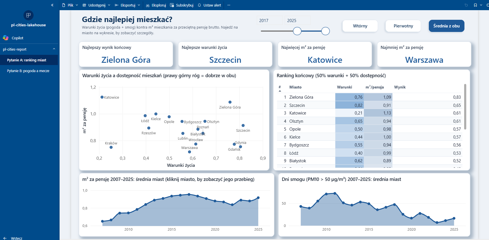
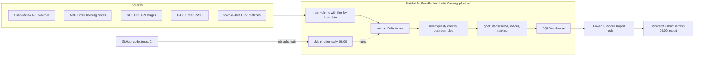
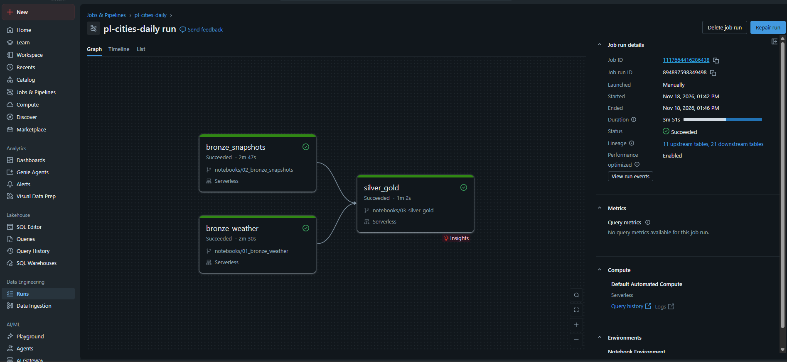
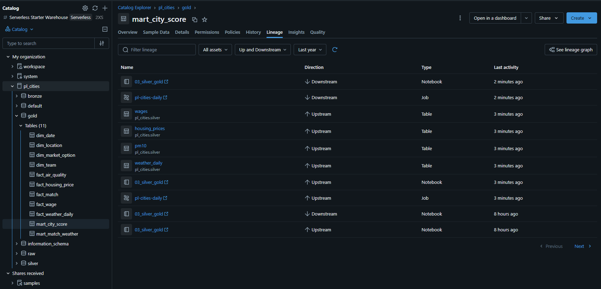

# pl-cities-lakehouse

End-to-end data platform for Polish cities: housing prices, wages, weather, air quality and football.
PySpark in a medallion architecture (bronze, silver, gold) on **Databricks** with **Delta Lake** and
**Unity Catalog**, a star schema, a daily scheduled job and a **Power BI** report refreshed in
**Microsoft Fabric**.

> **Status (November 2026):** the pipeline runs in the cloud every day without manual steps:
> at 06:00 a Databricks job loads and transforms the data, at 07:00 Fabric refreshes the Power BI model.
> The same code runs locally and in 89 unit tests (CI on every push). Details: [docs/progress.md](docs/progress.md).

## Questions

**Main question (A):** which large Polish cities offer the best balance between how affordable flats are
and how good the living conditions are, and how has it changed since 2007?

**Extra module (B):** do rain, wind and temperature on match day affect goals and home advantage in Ekstraklasa?

## Results

**Question A, 2025, secondary market:** Szczecin, Zielona Góra and Łódź lead the ranking; Kraków and Warszawa
come last (smog and the most expensive flats per wage). The coast has the best living conditions, Katowice the
most affordable flats; the ranking shows the trade-off between the two. On the primary market and for the average
of both markets Zielona Góra wins. Since 2007 wages grew faster than prices, so one average wage buys more m²
in every city, and smog days fell sharply (Kraków: from 157 to 23.5 a year).



**Module B:** weather on match day has almost no relation to the result: correlation with goals is close to zero
(rain −0.006, temperature 0.038, wind −0.013) across 4,082 matches. A negative result is a result too.

The rankings come from an index I defined myself, so they are rankings under that definition, not proof of causation.
Definitions and limitations: [docs/quality-of-life-index.md](docs/quality-of-life-index.md),
[docs/module-b-weather-football.md](docs/module-b-weather-football.md).

## How the indices work

- **Quality of life (0–1):** 50% weather (rainy days 40%, frost days 40%, hot days 20%) + 50% air (days with PM10
  above 50 µg/m³). Each component is min-max scaled within its year: 1 = best of the 17 cities that year.
- **Affordability:** average gross monthly wage / average transaction price per m², i.e. m² of a flat per wage;
  primary and secondary market kept separately.
- **Final score:** 50% quality of life + 50% affordability score, ranked per year and market.

## Architecture



**Daily job (Databricks Workflows):**

```
01_bronze_weather    (incremental, MERGE)  ──┐
                                             ├──►  03_silver_gold  (full recalculation)
02_bronze_snapshots  (full overwrite)      ──┘
```

The two ingestion tasks run in parallel and retry on temporary API errors; silver and gold start only when both
succeed, so a failed load leaves yesterday's gold untouched. A failure sends an e-mail. The job takes a few
minutes and runs the code straight from the `main` branch on GitHub.



Unity Catalog records lineage on its own: for `mart_city_score` it shows the silver tables it is built from
and the notebook and job that write it.



## Design decisions

| Decision | Why |
| --- | --- |
| Logic in a Python package, notebooks only call it | the same functions run locally, in unit tests (CI) and on Databricks; notebooks stay thin |
| Every transformation takes and returns a DataFrame | the caller decides where data comes from (files or Delta tables) and where it goes |
| Weather: incremental load with `MERGE` on `city` + `date` | new days arrive daily; every run re-fetches the last week (the source corrects recent values) and `MERGE` updates instead of duplicating, so reruns are idempotent |
| Other sources: full overwrite | NBP, GUS, GIOŚ and the football CSV publish their whole history in every file (snapshots) |
| Raw files kept unchanged, in folders named by load date | parsing can be redone without the API, and every result can be traced back to what the source sent that day |
| Silver stops on bad data | duplicate keys, empty values, impossible ranges or missing days raise an error before anything reaches gold |
| `dim_team` as SCD2 | stadium relocations give a team several versions; each match joins the version valid on match day |
| Databricks Free Edition instead of Azure | the Azure free account was not available; Free Edition gives Spark, Delta, Unity Catalog and Workflows at no cost (see below) |
| Power BI in Import mode via SQL Warehouse | small data refreshed once a day: fast report, one query per table per day; DirectQuery would query Databricks on every click |
| Job reads code from Git, not from the workspace | what runs in the cloud is exactly what passed CI on `main` |

**On Azure:** in a company the data would sit in ADLS Gen2 on the company's subscription, Databricks would read it
through a Unity Catalog external location with a managed identity, and secrets would live in Key Vault.
The Spark code would not change.

**Data revisions found during migration:** after moving to the cloud the 2025 score of Szczecin moved from 0.642
to 0.634 (leaders unchanged). Comparing the score components, then a fresh API response with the stored raw file,
showed that Open-Meteo had recalculated its archive (mean temperature up to 0.4 °C different on ~220 days of 2025),
which moves days across the frost and heat thresholds. Kept raw files made this provable.

## Costs

| Item | Cost |
| --- | --- |
| Databricks Free Edition (serverless compute, SQL Warehouse, Unity Catalog, Workflows) | 0 |
| Microsoft Fabric (trial capacity: model, scheduled refresh, report) | 0 during the trial |
| GitHub (repository, Actions CI) | 0 |
| Power BI Desktop | 0 |
| **Total** | **0** |

Free Edition has usage limits and is meant for learning, not production. A Databricks vs Fabric comparison on the
same data is the next step.

## Data sources

| Domain | Source | Format | Coverage | Load |
| --- | --- | --- | --- | --- |
| Weather | Open-Meteo archive | API (JSON) | 34 towns, daily, from 2006-07 to 5 days ago | incremental, `MERGE` |
| Housing prices | NBP, BaRN database | Excel | 17 cities, quarterly, from Q3 2006 | snapshot |
| Wages | GUS BDL (variable 64428) | API with pagination | cities with powiat rights, yearly | snapshot |
| Air quality | GIOŚ yearly statistics | Excel | PM10 per station, 2000–2025 | snapshot |
| Football | football-data.co.uk | CSV | Ekstraklasa, seasons 2012/13 – 2025/26 | snapshot |

## Power BI

The report lives in [powerbi/](powerbi/) as a Power BI project (PBIP: report and model saved as text files,
so they are versioned like code). Two pages, one per question, plus a city tooltip page:

- **Question A:** year slider, market buttons (secondary, primary, average of both), KPI cards, quality of life vs
  affordability scatter, ranking table, time series for m² per wage and smog days;
- **Question B:** KPI cards and home win share by rain, temperature and wind.

Measures, pages and the theme are generated by [scripts/build_pbir.py](scripts/build_pbir.py).
[scripts/set_powerbi_source.py](scripts/set_powerbi_source.py) points all tables at Databricks
(`pl_cities.gold.*`) or back at local Parquet files; host and HTTP path are model parameters and the access
token is never stored in the files. Model description: [docs/power-bi-model.md](docs/power-bi-model.md).

## Getting started

### Local

Requirements: Python 3.10+ and Java 17 (needed by Spark), Windows or Linux.

```powershell
python -m venv .venv
.\.venv\Scripts\Activate.ps1
pip install -e ".[dev]"
pytest
ruff check .
python -m pl_cities_lakehouse.export_gold     # raw files in data/raw -> gold Parquet in data/gold
python scripts/build_pbir.py powerbi          # Power BI measures and pages (Power BI Desktop closed)
```

Raw data is not in the repository; each module in `src/pl_cities_lakehouse/ingestion/` has a download function.
On Windows Spark cannot write files without winutils, so locally the pipeline runs in memory and gold is written
with pandas.

### Databricks

1. Create the catalog, schemas and volume:
   `CREATE CATALOG pl_cities`, schemas `raw`, `bronze`, `silver`, `gold`, volume `pl_cities.raw.files`.
2. Add the repository as a Git folder and run the notebooks in [notebooks/](notebooks/) in order
   (serverless compute).
3. Create a job with the three notebooks as tasks (source: Git, branch `main`), the two bronze tasks in parallel.

## Repository layout

```
src/pl_cities_lakehouse/
    ingestion/        # bronze: download and parse each source, incremental weather ranges
    transformations/  # silver (quality, rules) and gold (indices, ranking, star schema)
    common/           # cities, teams, Spark session, data quality checks, Delta MERGE
    pipeline.py       # silver and gold steps shared by the local export and Databricks
    export_gold.py    # local run: raw files -> gold Parquet
notebooks/            # Databricks: bronze weather, bronze snapshots, silver and gold
scripts/              # Power BI report generator, Power BI data source switch
powerbi/              # Power BI project (PBIP)
tests/                # unit tests for every stage
docs/                 # plan, index definition, findings, Power BI model, interview notes, progress
```

## Roadmap

- [x] Local setup, repository, CI
- [x] Bronze, silver, gold, star schema with SCD2, module B
- [x] Power BI report, published to Fabric
- [x] Databricks: Unity Catalog, Delta tables, incremental `MERGE`
- [x] Orchestration: daily Databricks job with alerts, code from Git
- [x] Power BI on Databricks, scheduled refresh in Fabric
- [ ] Databricks vs Fabric comparison
- [ ] Job definition as code (Databricks Asset Bundles)

Plan in Polish: [docs/plan.md](docs/plan.md).

## Secrets

Secrets never go to the repository. Locally use `.env` (see `.env.example`); access tokens for Power BI are entered
in Power BI Desktop and in the Fabric model settings, and expire after 90 days.

## License

MIT
