# pl-cities-lakehouse

End-to-end data platform for Polish cities: housing prices, wages, weather, air quality and football,
built with PySpark in a medallion architecture (bronze, silver, gold), a star schema and a Power BI report.
Azure (ADLS Gen2, Databricks, Delta) is the next stage.

> **Status (November 2026):** the whole pipeline runs locally and is tested (83 tests, CI on every push).
> Gold tables are exported to Parquet and feed a Power BI report, also published to Microsoft Fabric.
> Cloud storage, Delta tables and orchestration come next. Details: [docs/progress.md](docs/progress.md).

## Questions

**Main question (A):** which large Polish cities offer the best balance between how affordable flats are
and how good the living conditions are, and how has it changed since 2007?

**Extra module (B):** do rain, wind and temperature on match day affect goals and home advantage in Ekstraklasa?

## Results so far

**Question A, 2025, secondary market:** Szczecin, Zielona Góra and Łódź lead the ranking; Kraków and Warszawa
come last (smog and the most expensive flats per wage). The coast has the best living conditions, Katowice the
most affordable flats; the ranking shows the trade-off between the two. On the primary market and for the average
of both markets Zielona Góra wins. Since 2007 wages grew faster than prices, so one average wage buys more m²
in every city, and smog days fell sharply (Kraków: from 157 to 23.5 a year).

**Module B:** weather on match day has almost no relation to the result: correlation with goals is close to zero
(rain −0.006, temperature 0.038, wind −0.013) across 4,082 matches. A negative result is a result too.

The rankings come from an index I defined myself, so they are rankings under that definition, not proof of causation.
Definitions and limitations: [docs/quality-of-life-index.md](docs/quality-of-life-index.md),
[docs/module-b-weather-football.md](docs/module-b-weather-football.md).

## How the indices work

- **Quality of life (0–1):** 50% weather (rainy days 40%, frost days 40%, hot days 20%) + 50% air (days with PM10
  above 50 µg/m³). Each component is min-max scaled within its year: 1 = best of the 17 cities that year.
- **Affordability:** average gross monthly wage / average transaction price per m², i.e. m² of a flat per wage;
  primary and secondary market kept separately.
- **Final score:** 50% quality of life + 50% affordability score, ranked per year and market.

## Architecture

```mermaid
flowchart LR
    subgraph SRC[Sources]
        S1[NBP Excel: housing prices]
        S2[Open-Meteo API: weather]
        S3[GUS BDL API: wages]
        S4[GIOŚ Excel: PM10]
        S5[football-data CSV: matches]
    end
    subgraph LOCAL[Local today, Databricks + ADLS next]
        R[raw files] --> B[Bronze: parsed + load metadata]
        B --> SI[Silver: quality checks, business rules]
        SI --> G[Gold: indices, ranking, star schema]
    end
    SRC --> R
    G --> P[Parquet export]
    P --> PBI[Power BI report]
    PBI --> FAB[Microsoft Fabric workspace]
```



**Design choices worth knowing:**
- every transformation takes and returns a Spark DataFrame, so the same code runs locally, in tests and on Databricks;
- raw responses are stored as they came, so parsing can be redone without calling the sources again;
- silver stops the pipeline on bad data (duplicate keys, empty values, impossible ranges, missing days);
- `dim_team` is a slowly changing dimension (SCD2): stadium relocations give a team several versions, and each
  match joins the version valid on match day;
- results were checked in two independent implementations: PySpark (gold) and DAX measures in the published model.

## Data sources

| Domain | Source | Format | Coverage |
| --- | --- | --- | --- |
| Housing prices | NBP, BaRN database | Excel | 17 cities, Q3 2006 – Q2 2026 |
| Weather | Open-Meteo archive | API (JSON) | 34 towns, daily, 2006-07 – 2026-06 |
| Wages | GUS BDL (variable 64428) | API with pagination | cities with powiat rights, 2002–2025 |
| Air quality | GIOŚ yearly statistics | Excel | PM10 per station, 2000–2025 |
| Football | football-data.co.uk | CSV | Ekstraklasa, seasons 2012/13 – 2025/26 |

## Power BI

The report lives in [powerbi/](powerbi/) as a Power BI project (PBIP: report and model saved as text files,
so they are versioned like code). Two pages, one per question, plus a city tooltip page:

- **Question A:** year slider, market buttons (secondary, primary, average of both), KPI cards, quality of life vs
  affordability scatter, ranking table, time series for m² per wage and smog days;
- **Question B:** KPI cards and home win share by rain, temperature and wind.

Measures, pages and the theme are generated by [scripts/build_pbir.py](scripts/build_pbir.py).
Model description: [docs/power-bi-model.md](docs/power-bi-model.md).

## Getting started (local)

Requirements: Python 3.10+ and Java 17 (needed by Spark), Windows or Linux.

```powershell
python -m venv .venv
.\.venv\Scripts\Activate.ps1
pip install -e ".[dev]"
pytest
ruff check .
python -m pl_cities_lakehouse.export_gold     # raw files in data/raw -> gold Parquet in data/gold
python scripts/build_pbir.py powerbi          # Power BI measures and pages (Power BI Desktop closed)
```

Raw data is not in the repository; each module in `src/pl_cities_lakehouse/ingestion/` has a download function.
On Windows Spark cannot write files without winutils, so the pipeline runs in memory and gold is written with pandas.

## Repository layout

```
src/pl_cities_lakehouse/
    ingestion/        # bronze: download and parse each source
    transformations/  # silver (quality, rules) and gold (indices, ranking, star schema)
    common/           # cities, teams, Spark session, data quality checks
    export_gold.py    # whole pipeline, gold tables to Parquet
scripts/              # Power BI report generator
powerbi/              # Power BI project (PBIP)
tests/                # unit tests for every stage
docs/                 # plan, index definition, findings, Power BI model, interview notes, progress
```

## Roadmap

- [x] Local setup, repository, CI
- [x] Bronze: five sources
- [x] Silver: data quality checks and business rules
- [x] Gold: indices, ranking, star schema with SCD2
- [x] Module B: weather and football
- [x] Power BI report, published to Fabric
- [ ] Azure: ADLS Gen2, Databricks, Delta tables, MERGE for incremental loads
- [ ] Orchestration (Databricks Workflows or Data Factory) and alerts
- [ ] Fabric comparison and cost table

Plan in Polish: [docs/plan.md](docs/plan.md).

## Secrets

Secrets never go to the repository. Use `.env` locally (see `.env.example`) and Key Vault in Azure.

## License

MIT
