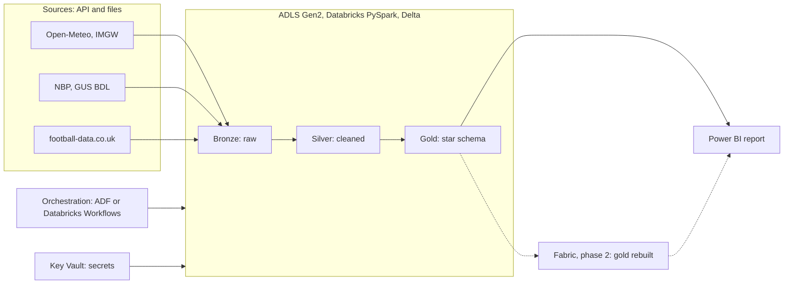

# pl-cities-lakehouse

End-to-end data platform on Azure: PySpark, Delta, medallion architecture, Power BI. Housing prices, weather and football data for Polish cities.

> Status: planning and local setup. Azure resources come after the first parsers work locally.

## Question

**Main question (A):** which large Polish cities offer the best ratio of housing price per m² to a quality-of-life index, and how has this ratio changed over the last 10 years?

**Extra module (B):** do rain, wind and temperature affect goals and home advantage in Ekstraklasy matches?

The quality-of-life index is my own normalised score (for example days with rain, winter temperature, optionally air quality). The result is a ranking and correlations under that definition, not proof of causation.

## Architecture



## Stack

Azure (ADLS Gen2, Databricks, Key Vault, Data Factory or Databricks Workflows), PySpark, Delta Lake, Power BI, Microsoft Fabric (phase 2), GitHub Actions.

## Data sources

| Domain | Source | Format |
| --- | --- | --- |
| Weather | Open-Meteo, IMGW | API (JSON), CSV in ZIP |
| Housing | NBP, GUS BDL | Excel, API |
| Air quality (optional) | GIOS | API |
| Football | football-data.co.uk | CSV |

Licences, limits and formats are checked per source before ingestion.

## Roadmap

- [ ] Week 1: local setup, repo skeleton, source samples
- [ ] Week 2-3: ingestion to bronze (weather, housing)
- [ ] Week 4: silver (dedup, standardisation, quality tests, idempotent MERGE)
- [ ] Week 5: gold and answer to question A
- [ ] Week 6: football module (B)
- [ ] Week 7: orchestration and Power BI
- [ ] Week 8: Fabric comparison and documentation

Details: [docs/plan.md](docs/plan.md) (in Polish).

## Getting started (local)

Requirements: Python 3.10+ and Java 17 (needed by Spark).

```powershell
python -m venv .venv
.\.venv\Scripts\Activate.ps1
pip install -e ".[dev]"
pytest
ruff check .
```

## Repository layout

```
src/pl_cities_lakehouse/
    ingestion/        # download from APIs and files
    transformations/  # bronze -> silver -> gold (PySpark)
    common/           # config, Spark session, helpers
tests/                # unit and data quality tests
notebooks/            # exploration only
infra/                # Azure setup scripts
docs/                 # plan, decisions, weekly checklists
```

## Secrets

Secrets never go to the repository. Use `.env` locally (see `.env.example`) and Key Vault in Azure.

## License

MIT
