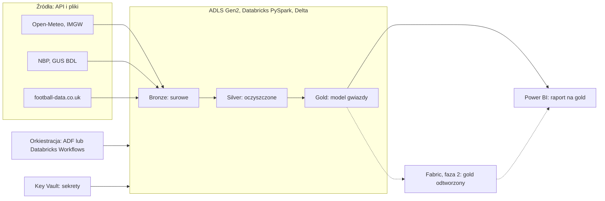

# Plan projektu: Azure, PySpark i Fabric

Data: 2026-10-22

## Cel i główne pytanie

Projekt buduje jedną platformę danych na Azure, która odpowiada na pytanie A i ma dołożony moduł B na tych samych wymiarach daty i miasta.

**Pytanie A (główne):** które duże polskie miasta mają najlepszy stosunek ceny za m² mieszkania do wskaźnika warunków życia i jak ten stosunek zmienił się w ostatnich 10 latach?

**Moduł B (dodatkowy):** czy opady, wiatr i temperatura wpływają na liczbę goli i domową przewagę w meczach Ekstraklasy?

**Definicje (ustalone 2026-10-22, szczegóły w [quality-of-life-index.md](quality-of-life-index.md)):**

- Lista miast: 17 miast z danych NBP (16 miast wojewódzkich i Gdynia).
- Wskaźnik warunków życia: 50% pogoda (dni z deszczem 40%, dni z mrozem 40%, dni upalne 20%) i 50% powietrze (dni z przekroczoną normą PM10, GIOŚ), normalizacja min-max w obrębie roku.
- Dostępność mieszkań: przeciętne wynagrodzenie (GUS BDL) podzielone przez cenę transakcyjną za m², czyli ile m² kupisz za jedną pensję.
- Wspólny poziom porównania cen (kwartalne) i pogody (dzienna) to rok; ranking tylko dla pełnych lat.

**Ograniczenie:** wynik to ranking i korelacje według przyjętego wskaźnika, a nie dowód przyczynowości. Warto to napisać w README.

## Źródła danych

Każda domena dostaje inny sposób pobierania, co pokazuje dwa wzorce ingestion: API i pliki. Licencje, formaty i dostępność trzeba sprawdzić przed startem, bo mogą się zmieniać.

| Domena | Źródło | Format | Ziarnistość | Do sprawdzenia |
| --- | --- | --- | --- | --- |
| Pogoda | Open-Meteo (historia) | API, JSON | dzień | limity zapytań, zakres historii |
| Pogoda | IMGW (archiwum) | CSV w ZIP | dzień | struktura plików, kodowanie |
| Mieszkania | NBP: ceny mieszkań w największych miastach | Excel | kwartał | układ arkuszy, nazwy miast |
| Mieszkania i wynagrodzenia | GUS BDL | API | rok | przeciętne wynagrodzenie w miastach, dostępne wskaźniki |
| Powietrze | GIOŚ | API | godzina lub dzień | stacje przypisane do miast |
| Piłka | football-data.co.uk (Ekstraklasa) | CSV | mecz | zakres sezonów, nazwy drużyn |

Scrapowania portali z ogłoszeniami unikamy ze względu na regulaminy.

## Architektura

Dane z API i plików trafiają przez bronze i silver do gold w ADLS, a Power BI czyta gold. Fabric odtwarza gold w tygodniu 8 i służy do porównania z Databricks.

## Model danych (gold)

Model gwiazdy ze wspólnymi wymiarami daty i lokalizacji, dzięki którym pogoda, ceny i mecze łączą się bez osobnych kopii słowników.

| Tabela | Rodzaj | Ziarno | Uwagi |
| --- | --- | --- | --- |
| dim_date | wymiar | dzień | rok, kwartał, miesiąc, sezon piłkarski |
| dim_location | wymiar, SCD2 | miasto | miasto, powiat, województwo, historia zmian nazw i przypisań |
| dim_team | wymiar | drużyna | przypisanie do miasta stadionu |
| fact_weather_daily | fakt | miasto, dzień | temperatura, opady, wiatr |
| fact_housing_price | fakt | miasto, kwartał | cena za m², rynek pierwotny i wtórny, jeśli dane to pozwalają |
| fact_match | fakt | mecz | gole, wynik, miasto i data meczu do złączenia z pogodą |
| fact_wage | fakt | miasto, rok | przeciętne miesięczne wynagrodzenie brutto (GUS BDL) |
| fact_air_quality_daily | fakt | miasto, dzień | średnie dobowe PM10 (GIOŚ) |
| mart_city_score | widok biznesowy | miasto, rok | wskaźnik warunków życia, dostępność mieszkań (m² za pensję) i ranking |

SCD2 na `dim_location` ma sens, bo nazwy i przypisania administracyjne potrafią się zmieniać, a w danych NBP nazwy miast trzeba ujednolicać. Klucze surogatowe i złączenia po nich sprawdzamy testami.

## Harmonogram

Plan zakłada ok. 8 tygodni przy kilku godzinach pracy tygodniowo. Fabric wchodzi dopiero po tym, jak PySpark na Databricks działa end-to-end. Terminy są orientacyjne i zależą od czasu, który możesz poświęcić.

| Tydzień | Etap | Co powstaje | Kryterium ukończenia |
| --- | --- | --- | --- |
| 1 | Start i środowisko | konto Azure, budżet z alertami, resource group, ADLS Gen2, workspace Databricks, repo na GitHubie ze szkieletem | pusty notebook zapisuje plik do ADLS, alert kosztowy działa |
| 2 | Ingestion pogody (bronze) | notebook PySpark pobiera dane z Open-Meteo, zapis do Delta, ładowanie inkrementalne | ponowne uruchomienie nie duplikuje danych |
| 3 | Ingestion mieszkań (bronze) | parsowanie plików NBP (Excel) i GUS BDL (API) do Delta | wszystkie kwartały i miasta w bronze, logi ładowania |
| 4 | Silver | deduplikacja, standaryzacja nazw miast, testy jakości, MERGE idempotentny | zestaw testów przechodzi, uruchomienie 3 razy daje ten sam wynik |
| 5 | Gold i pytanie A | dim_date, dim_location (SCD2), fakty, wskaźnik warunków życia, mart_city_score | zapytanie zwraca ranking miast dla wybranego roku |
| 6 | Moduł B | football-data.co.uk do bronze, silver, fact_match, złączenie z pogodą | tabela mecz + pogoda w dniu meczu, wstępna analiza |
| 7 | Orkiestracja i Power BI | Azure Data Factory lub Databricks Workflows, raport w Power BI na gold, alert przy błędzie | pipeline uruchamia się sam, raport odpowiada na pytanie A |
| 8 | Fabric i dokumentacja | odtworzenie warstwy gold we Fabric, porównanie czasu, kosztu i wygody pracy, README z diagramem | dokument porównawczy i gotowe publiczne repo |

## Konto, koszty i bezpieczeństwo

Zakładamy darmowe konto Azure z kredytem startowym oraz darmowy plan Databricks lub okres próbny. Aktualne limity, czas ważności kredytu i warunki planów trzeba sprawdzić na stronach Microsoftu i Databricks przed założeniem konta, bo często się zmieniają.

- Budżet i alerty kosztowe ustawiasz w pierwszym kroku, zanim powstanie jakikolwiek zasób.
- Klastry Databricks mają automatyczne wyłączanie po krótkim czasie bezczynności i najmniejszy możliwy rozmiar.
- Dane trzymamy w jednej grupie zasobów, żeby po projekcie usunąć całość jednym ruchem.
- Sekrety (klucze API, connection stringi) trafiają do Key Vault, nigdy do repozytorium.
- Dostęp przez RBAC i konto z najmniejszymi potrzebnymi uprawnieniami, a nie konto właściciela do wszystkiego.
- Repo na GitHubie z plikiem `.gitignore` obejmującym dane i pliki konfiguracyjne z sekretami.
- Fabric uruchamiamy dopiero w tygodniu 8, żeby ograniczyć czas działania płatnej pojemności. Warunki wersji próbnej do sprawdzenia.

## Ryzyka i kryteria sukcesu

| Ryzyko | Jak ograniczyć |
| --- | --- |
| Dane NBP zmieniają układ arkuszy między kwartałami | parser z walidacją schematu i testem, który zatrzymuje ładowanie |
| Niezgodne nazwy miast w źródłach | słownik miast w dim_location i test pokrycia |
| Koszty poza darmowym limitem | budżet z alertem, auto-wyłączanie klastrów, usunięcie zasobów po etapie |
| Zakres rośnie (GIOŚ, piłka, makro) | rdzeń to pytanie A, reszta to moduły dokładane po zamknięciu poprzedniego etapu |
| Zbyt słaby związek pogody z meczami | wynik negatywny też jest wynikiem, opisujemy go w README |

**Kryteria sukcesu:**

- Pipeline od surowych danych do raportu uruchamia się bez ręcznych kroków.
- Powtórne uruchomienie daje ten sam wynik (idempotentność) i ma testy jakości.
- Raport w Power BI odpowiada na pytanie A.
- Repo na GitHubie ma README z diagramem architektury, opisem decyzji i tabelą kosztów.
- Powstaje krótkie porównanie Databricks i Fabric na tych samych danych.
- Każdą decyzję projektową potrafisz wytłumaczyć na rozmowie rekrutacyjnej.
